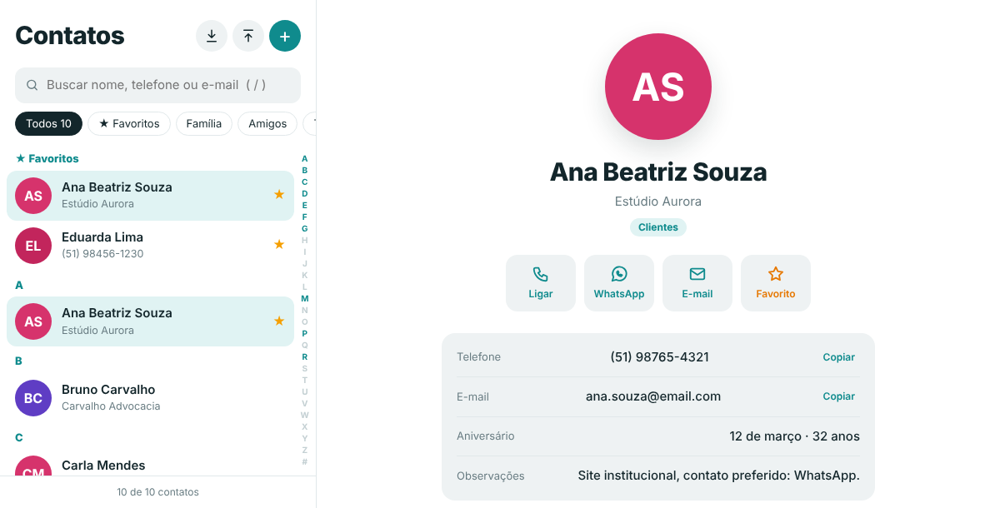

# ContactBook — Agenda de contatos

Agenda de contatos com nome, telefone, e-mail e foto, busca rápida e exportação dos dados em JSON.

🔗 **[Ver o site no ar](https://iamviniciuslima05.github.io/PROJETO-ContactBook/)**



## Funcionalidades

- Cadastro com **nome, telefone, e-mail, foto**, empresa, grupo e aniversário
- **Foto** reduzida automaticamente antes de salvar
- **Busca rápida** por nome, telefone ou e-mail (atalho /)
- Lista em ordem alfabética com **índice de letras**
- Grupos e **favoritos**
- Atalhos para **ligar, WhatsApp e e-mail**
- **Exportar e importar** contatos em JSON
- Validação de telefone e e-mail

## Tecnologias

HTML5 · CSS3 · JavaScript · Canvas · localStorage

## Estrutura

```
index.html
css/style.css
js/script.js
```

## Como rodar

Não precisa instalar nada: baixe o projeto e abra o `index.html` no navegador, ou acesse a versão publicada acima.

---
Feito por **Vinicius Lima** · [Portfólio](https://viniciuslimadev.netlify.app) · [LinkedIn](https://www.linkedin.com/in/viniciuslima25/)
